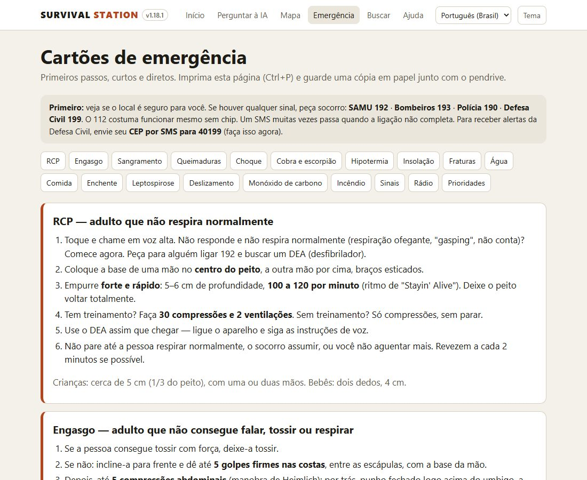

# Survival Station — kit de sobrevivência offline

*[English: README.md](README.md)*

**Um kit de emergência gratuito que funciona sem internet.** Primeiros socorros, mapas offline, guia de rádio,
ferramentas e um assistente de IA que cita as fontes, tudo num pendrive. Conecte em qualquer notebook e funciona:
sem instalar nada, sem cadastro. Os celulares no roteador do notebook também usam.



**Por quê:** governos recomendam que cada casa esteja pronta para pelo menos 72 horas por conta própria
([Defesa Civil](https://www.gov.br/mdr/pt-br/assuntos/protecao-e-defesa-civil), [Cruz Vermelha](https://www.redcross.org/get-help/how-to-prepare-for-emergencies/survival-kit-supplies.html)).
Água, comida e lanterna estão em todas as listas; informação confiável quando a internet e o celular caem, quase
nunca. Cadastre-se também nos alertas da Defesa Civil: envie seu CEP por SMS para 40199.

### Começo rápido
1. Num computador **Windows** com internet, baixe este projeto (**Code → Download ZIP**) e descompacte.
2. Conecte um pendrive (32 a 256 GB, formatado em exFAT) e clique duas vezes em **`MAKE-USB.bat`**.
3. Escolha o tamanho (**Lite**, **Standard** ou **Full**), os idiomas e os mapas e clique em **Montar o pendrive**. Ele baixa tudo, o que demora.
4. Quando aparecer Done, rode **`START-WINDOWS.bat`** no pendrive (Mac: `START-MAC.command`; Linux: `START-LINUX.sh`) e teste.
5. Compartilhe: o **`COPY-KIT.bat`** copia um kit pronto para outro pendrive, sem internet.

Folhetos para imprimir e divulgar: [Português](promo/flyer-pt-BR.pdf) · [English](promo/flyer-en.pdf).

Um kit de sobrevivência que roda direto de um pendrive, **sem internet e sem instalar nada**. Conecte num computador, clique duas vezes em um arquivo e você tem:

- **Assistente de IA local**, que roda no processador do computador e responde em português. Antes de responder, **busca na biblioteca offline** e mostra os artigos usados como fontes numeradas.
- **Biblioteca offline** (Kiwix), com Wikipédia em português, Wikipédia médica, Wikilivros e Wikiviagem, além dos guias em inglês de água, alimentos, desastres e primeiros socorros.
- **Mapas offline**: o mundo todo, mais ruas do Brasil ou do seu estado. Toque em qualquer ponto para ver as coordenadas e passar ao resgate.
- **Cartões de emergência em português**: RCP, sangramento, queimaduras, picada de cobra, leptospirose, enchente, deslizamento, água potável e telefones (SAMU 192, Bombeiros 193, Defesa Civil 199). Imprima e guarde junto com o pendrive.
- **Survival-Data** (opcional, desmarcado por padrão): manuais e PDFs de preparação, rádio e medicina, em inglês. O repositório não informa licença e inclui livros comerciais, então adicionar e compartilhar é decisão sua (veja `THIRD-PARTY-NOTICES.md`).
- **Celular**: qualquer celular conectado ao mesmo Wi-Fi ou roteador do celular acessa tudo pelo navegador.

**Para quem vai usar o kit:** o portal tem uma página de **Ajuda** (`portal/help.html`) que explica como iniciar, cada função, o uso no celular e o que fazer quando algo dá errado. Ela abre mesmo sem nada rodando. Este LEIA-ME é para quem monta o pendrive.

O idioma é escolhido automaticamente pelo idioma do aparelho. Para trocar, use o menu no topo da página.

> **Importante: use por sua conta e risco.** O Survival Station reúne material gratuito publicado por outros (a biblioteca, os mapas e os modelos de IA) e resumos curtos de orientações públicas de emergência (os cartões de emergência, a página de rádio e as ferramentas). Nada disso foi revisado por profissionais de saúde, jurídicos ou de emergência para este kit. É uma ferramenta de consulta, não substitui o socorro, os médicos nem as orientações oficiais. A IA pode errar, e a biblioteca e os guias podem estar desatualizados ou não servir para o seu caso. Sempre que puder, chame ajuda profissional (SAMU 192, Bombeiros 193, Defesa Civil 199), siga as autoridades e confira assuntos de saúde nos cartões de emergência e com alguém qualificado. Use transmissores de rádio só como a lei permite. É fornecido "no estado em que se encontra", sem garantia de nenhum tipo, e seus autores e colaboradores não se responsabilizam por erros, informações incorretas, mau uso, pelas respostas que dá nem pelo material que ele contém ou baixa (veja `LICENSE`).

## 1. Montar o pendrive (faça agora, enquanto tem internet)

1. Use um pendrive de **32 GB ou mais** e formate em **exFAT**. FAT32 não aceita arquivos grandes.
2. **Mais fácil:** clique duas vezes em **`MAKE-USB.bat`**. Abre uma janela com cada modelo de IA, livro da biblioteca, mapa e extra em uma caixa de marcar, com o tamanho atual de cada um. O total, e se cabe no pendrive escolhido, se atualizam enquanto você marca. Os botões Lite / Standard / Full marcam um nível inteiro nos seus idiomas, e depois você ainda ajusta item por item. A janela também formata o pendrive em exFAT, adiciona uma área de mapa sua e inicia o kit para testar. Prefere perguntas no terminal? Rode `MAKE-USB.bat text` ou `py make-usb.py`. Se preferir, abra o PowerShell nesta pasta e rode:

```powershell
powershell -ExecutionPolicy Bypass -File setup\build-drive.ps1 -Drive E: -Tier Lite -Languages en,pt -Map brazil
```

- Troque `E:` pela letra do seu pendrive.
- `-Map brazil` traz as ruas do Brasil todo (6,1 GB). Para economizar espaço, use só o seu estado: `-Map rio-grande-do-sul`, `santa-catarina`, `parana`, `sao-paulo`, `rio-de-janeiro`, `minas-gerais`, `bahia` ou `pernambuco`. Também dá para usar `-MapMaxZoom 14` (menos detalhe, metade do tamanho).
- **Pendrive inicializável (opcional):** o `MAKE-BOOTABLE.bat` (Windows) adiciona o Ventoy e o Linux Mint, para o pendrive iniciar um computador cujo disco ou Windows falhou, rodar o kit e salvar arquivos. Ele apaga o pendrive na primeira vez: copie o kit antes e depois com o `COPY-KIT.bat`.
- `-Tier Standard`, com um pendrive de 64 GB, inclui a Wikipédia em português completa (só texto), uma IA mais inteligente e mais livros.
- Com o inglês marcado, o Standard e o Full também trazem perguntas e respostas de especialistas (cozinha, horta, marcenaria, artesanato, vida ao ar livre, radioamador, animais, consertos da casa e do carro), a Wikipédia em inglês simples e o PhET para crianças, os Wikibooks e livros antigos sobre agricultura (Gutenberg).

O programa mostra o tamanho de tudo e pergunta antes de baixar. Se a internet cair, rode de novo: ele continua de onde parou.

**Também (ou só) neste computador:** na janela, escolha **"Este computador, pasta C:\Survival"** no menu "Instalar em" (**Pasta...** escolhe outro lugar). É o mesmo kit, com um atalho **Survival Station** na área de trabalho, e funciona sem o pendrive. No modo texto, digite `L` na pergunta da unidade; na linha de comando, use `-Drive C:\Survival`. Se puder, monte os dois: a cópia no computador para casa e o pendrive para levar.

**Atualizações:** na janela, escolha o pendrive e clique em **Procurar atualizações**. Ele compara o kit com o que há online e mostra edições novas da biblioteca, um motor de IA mais novo, mapas com mais de um ano, um Survival-Data mais novo e páginas do app mais novas, com o tamanho de cada um, e atualiza se você confirmar. As edições novas substituem as antigas e nada mais muda. No modo texto é a opção 4 (`MAKE-USB.bat text`); na linha de comando, `build-drive.ps1 -Drive E: -Update`.

**Verificar / reparar:** o botão **Verificar / reparar** (opção 6 no modo texto) confere cada parte do kit e depois oferece copiar as páginas e ferramentas mais novas (segundos, sem internet) e baixar de novo o que faltar ou estiver incompleto. Pode usar mesmo com uma montagem rodando: o que ainda está baixando aparece como "em andamento" e não é mexido.

**Compartilhar sem internet:** todo kit traz o **`COPY-KIT.bat`**. Ele copia o kit para outro pendrive ou para uma pasta num computador, confere o espaço antes e pode formatar o outro pendrive em exFAT. Se parar, continua de onde parou, e não precisa de internet nem desta pasta do projeto. A janela do construtor também tem o botão **Copiar kit...**, e o kit leva o `MAKE-USB.bat` junto, para o pendrive poder se atualizar depois.

3. **Teste antes de precisar:** abra `START-WINDOWS.bat` no pendrive, faça uma pergunta à IA, abra a biblioteca e o mapa, e teste também pelo celular.

## 2. Usar

| Aparelho | Como |
|---|---|
| Windows | Clique duas vezes em `START-WINDOWS.bat`. Se o firewall perguntar, clique em **Permitir** (isso libera o acesso pelo celular). |
| Mac | Clique duas vezes em `START-MAC.command`. Se o macOS bloquear, clique com o botão direito e escolha **Abrir**. |
| Linux / Raspberry Pi 5 | `bash START-LINUX.sh` |
| Celular | Ligue o **roteador Wi-Fi do celular**, que funciona mesmo sem sinal e sem dados. Conecte o computador nele. No celular, abra o endereço `http://192.168.x.x:8080` que aparece na janela do computador. |
| Android sem computador | **Antes** de uma emergência, instale os apps da pasta `apps/android/`: Kiwix (biblioteca), PocketPal AI (IA no celular), Organic Maps e Meshtastic (mensagens LoRa). |
| iPhone sem computador | O iPhone não roda programas do pendrive. Instale antes o **Kiwix** e o **PocketPal AI** pela App Store e copie os arquivos para o celular. |

**Computador antigo ou com pouca memória (menos de 8 GB)?** Quando o programa perguntar, escolha o **Llama-3.2-1B**: é o mais rápido, mas responde de forma mais simples, então confira o que for importante nos cartões de emergência.

**Respostas lentas?** Desmarque "Consultar a biblioteca" embaixo do chat. A resposta sai mais rápido, mas sem as fontes.

## Importante

- A IA pode errar. Em situações de risco de vida, siga os **cartões de emergência** e procure socorro.
- Faça um curso de primeiros socorros enquanto pode.
- Cadastre-se nos alertas da Defesa Civil: envie seu **CEP por SMS para 40199**.
- Guarde uma cópia impressa dos cartões e, se puder, um pendrive reserva.

## Licença

O código e as páginas do Survival Station: **MIT** (`LICENSE`). Livre para usar, copiar, alterar e compartilhar,
inclusive em trabalho comunitário e de socorro.

Os programas, modelos de IA, livros, mapas e dados que o construtor baixa têm as próprias licenças, listadas em
[`THIRD-PARTY-NOTICES.md`](THIRD-PARTY-NOTICES.md), que vai em todo kit. Ao compartilhar um kit, elas vão junto.
Em especial:
- **Llama 3.2** e **Gemma 3** têm os termos e políticas de uso dos fabricantes.
- O **kiwix-serve** é GPL-3.0; o código-fonte está indicado no arquivo.
- Os guias do **iFixit** são não comerciais: não venda kits com eles.
- O **Survival-Data** é opcional, porque os direitos não estão claros.
