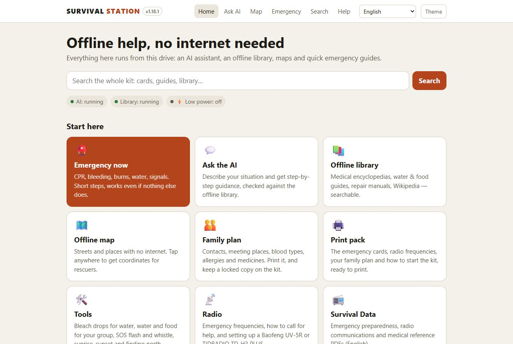
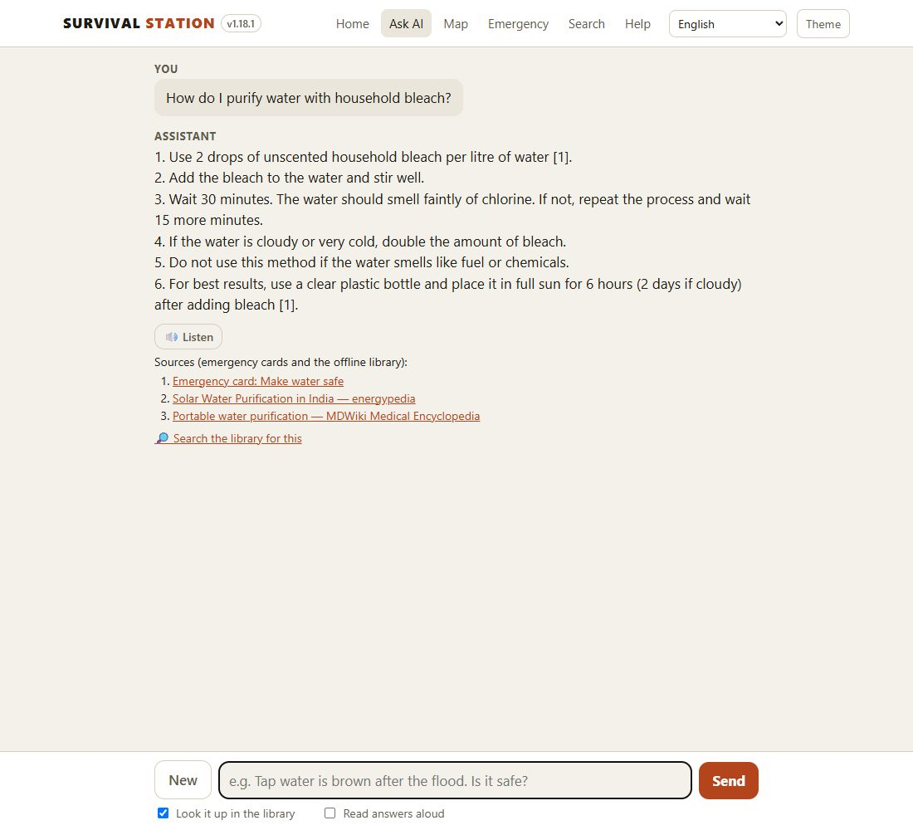
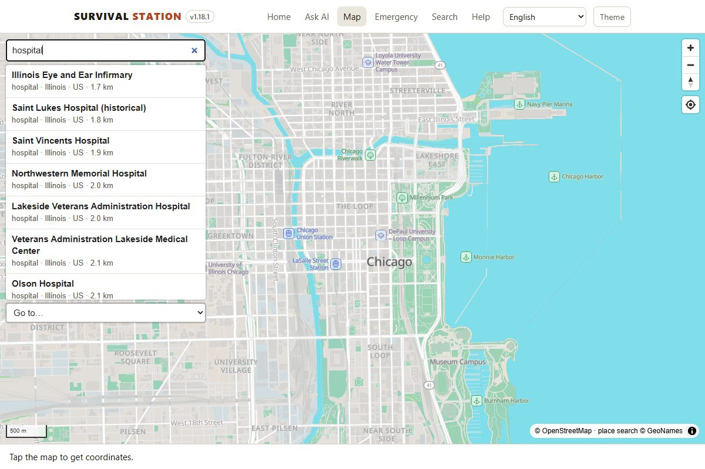
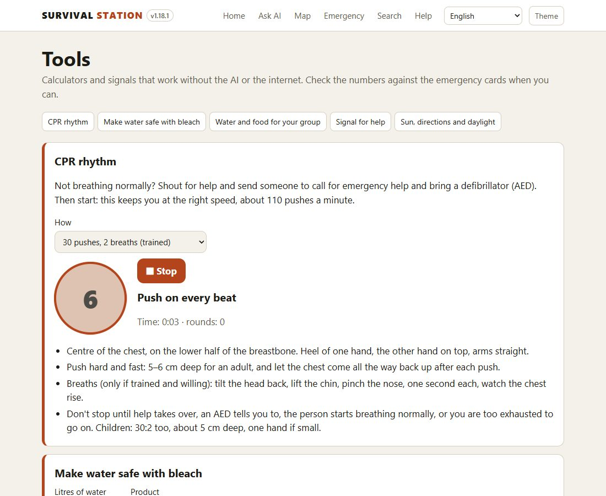
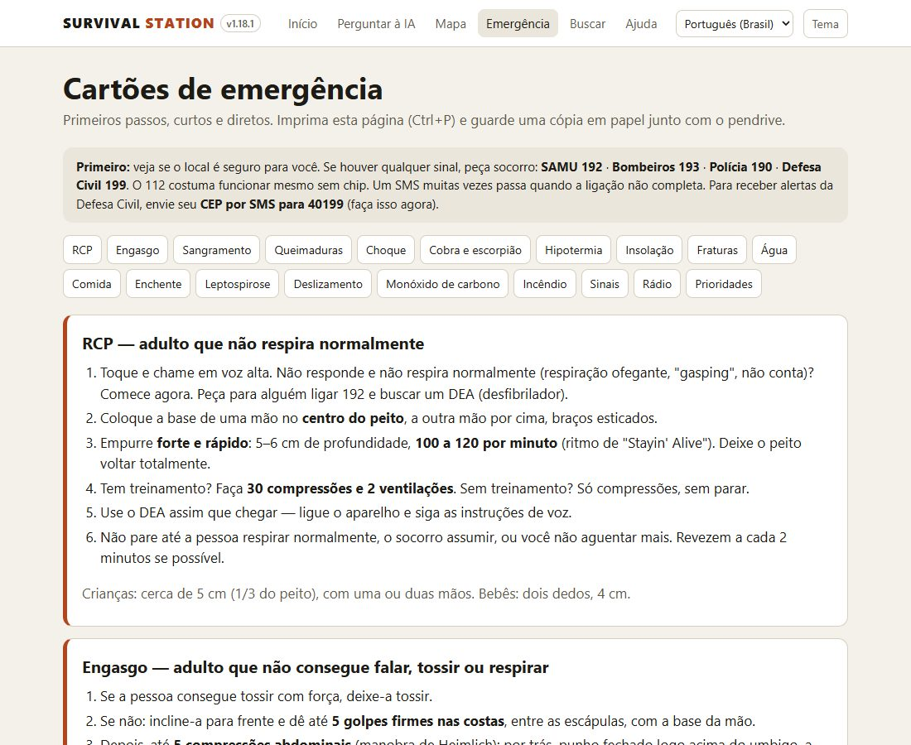
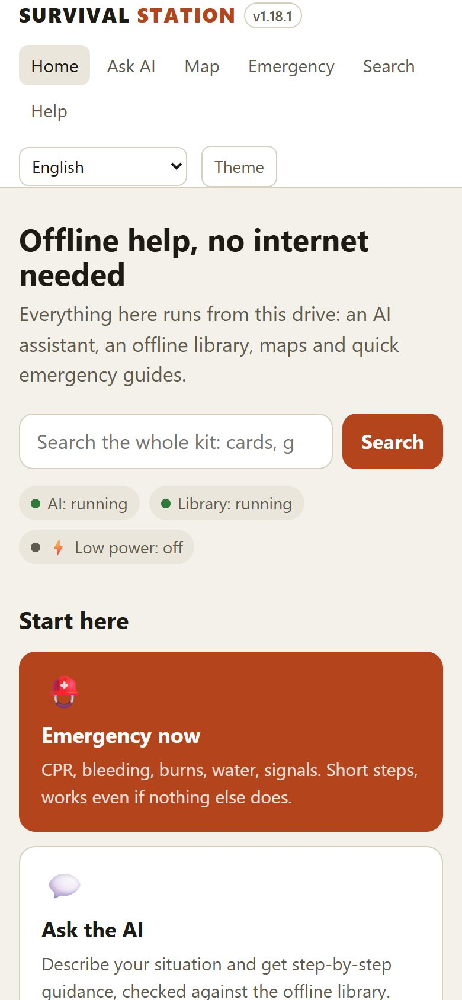

# Survival Station

*[Português (Brasil): LEIA-ME.md](LEIA-ME.md)*

**A free emergency kit that works with no internet.** First aid, offline maps, a radio guide, tools and an AI
assistant that cites its sources, all on a USB stick. Plug it into any laptop and it runs: nothing to install,
no account. Phones on the laptop's hotspot use it too.

| | |
|---|---|
|  |  |
|  |  |
|  |  |

**Why:** governments advise every household to be ready for at least 72 hours on its own
([USA](https://www.ready.gov/kit), [Canada](https://www.getprepared.gc.ca/cnt/kts/index-en.aspx),
[UK](https://prepare.campaign.gov.uk/), [Red Cross](https://www.redcross.org/get-help/how-to-prepare-for-emergencies/survival-kit-supplies.html),
[Brasil: Defesa Civil](https://www.gov.br/mdr/pt-br/assuntos/protecao-e-defesa-civil)). Food, water and a torch
are on every list. Reliable information, when the internet and phone networks are down, usually isn't.

### Quick start
1. On a **Windows** computer with internet, download this project (**Code → Download ZIP**) and unzip it.
2. Plug in a USB stick (32–256 GB, formatted exFAT) and double-click **`MAKE-USB.bat`**.
3. Pick a size (**Lite**, **Standard** or **Full**), your languages and maps, then click **Build the drive**. It downloads everything, which takes a while.
4. When it says Done, run **`START-WINDOWS.bat`** on the stick (Mac: `START-MAC.command`; Linux: `START-LINUX.sh`) and test it.
5. Share it: **`COPY-KIT.bat`** copies a finished kit to another stick with no internet.

Printable flyers to spread the word: [English](promo/flyer-en.pdf) · [Português](promo/flyer-pt-BR.pdf).

## What's on the kit

An offline survival kit that runs from a USB drive. Plug it into a computer, double-click one file, and you get:

- **A local AI assistant**: llama.cpp with Qwen3 / Llama models, running on the computer's CPU. No GPU and no internet needed. Before it answers, it **looks the question up in the offline library**, then shows the articles it used as numbered, clickable sources.
- **An offline library**: Kiwix archives of medical encyclopedias, water and food guides, post-disaster manuals, knots, Appropedia, iFixit and Wikipedia, in English and/or Portuguese.
- **Offline maps**: a world overview on every drive, plus street-level maps of the regions you pick. Tap anywhere to get coordinates to read out to rescuers.
- **[Survival-Data](https://github.com/PR0M3TH3AN/Survival-Data)** (optional, not ticked by default): preparedness, radio and emergency medical PDFs. Its repository states no licence and includes commercial books, so whether to add and share it is your decision (see `THIRD-PARTY-NOTICES.md`).
- **Emergency cards**: CPR, bleeding, burns, water purification, signals and radio. They are plain HTML pages, so they open even if nothing else starts, and they print well. The Portuguese version adds Brazil-specific cards: snakebites, leptospirosis, landslides, and the local emergency numbers.
- **Languages**: English and Português (Brasil). The interface, AI answers, emergency cards, library search and map labels all switch together. The phone or computer's language is picked automatically, and you can change it from the menu at the top.
- **Family plan, print pack and private documents**: a family emergency plan to fill in and print, a one-click print pack (cards, radio, plan, start instructions), and a `private/` folder for IDs and insurance papers that phones never see, locked with a password by `PRIVATE-DOCS.bat` (OpenSSL format: Mac/Linux use `bash launch/private-docs.sh`, or `openssl enc -d -aes-256-cbc -pbkdf2 -iter 200000 -md sha256`).
- **Search**: one box searches the emergency cards and kit pages, the Survival Data guides (including the text inside the PDFs, opening at the right page), your documents and the full text of the library.
- **Radio page**: emergency frequencies, how to call for help, and how to set up a Baofeng UV-5R or TIDRADIO TD-H3 PLUS, with a CHIRP channel file (`portal/radio/survival-channels.csv`).
- **Phone access**: phones on the same hotspot or Wi-Fi open the computer's address in a browser.
- **Android apps** to install ahead of time: Kiwix, PocketPal AI (runs the AI on the phone) and Organic Maps.

**For the people using the kit:** the portal has a built-in **Help** page (`portal/help.html`, English and Português). It covers starting the kit, every feature, phone access, and a troubleshooting table. It opens even when nothing is running. This README is for whoever builds the drive.

It works like Project N.O.M.A.D., but it's portable. N.O.M.A.D. is a server you install on a Linux box. This needs nothing installed: everything lives on the stick.

> **Important: use at your own risk.** Survival Station brings together free material published by others (the library, maps and AI models) with short summaries of public emergency guidance (the emergency cards, radio page and tools). None of it has been reviewed by medical, legal or emergency professionals for this kit. It is a reference tool, not a substitute for emergency services, doctors or official instructions. The AI can be wrong, and the library and guides may be out of date or not fit your situation. Always call for professional help when you can, follow the authorities' instructions, and check anything medical against the emergency cards and a qualified person. Use radio transmitters only as your country's law allows. It is provided "as is", without warranty of any kind, and its authors and contributors accept no responsibility or liability for errors, misinformation, misuse, the answers it gives, or the material it contains or downloads (see `LICENSE`).

## 1. Build the drive (do this now, while you have internet)

1. Get a USB drive (see sizes below) and **format it as exFAT**. FAT32 can't hold files bigger than 4 GB. exFAT works on Windows, Mac, Linux and Android.
2. **Easiest:** double-click **`MAKE-USB.bat`**. A window opens with every AI model, library book, map and extra as a checkbox, each with today's download size. The total and whether it fits on the chosen drive update as you tick. Buttons pick a whole tier (Lite / Standard / Full) in your languages, and you can still change single items afterwards. The window can also format the stick as exFAT, add your own map area, and start the kit for a test. Prefer questions in the terminal? Run `MAKE-USB.bat text` or `py make-usb.py`. Or run the builder yourself from this folder:

```powershell
powershell -ExecutionPolicy Bypass -File setup\build-drive.ps1 -Drive E: -Tier Lite
# English + Portuguese library, with street maps of Brazil:
powershell -ExecutionPolicy Bypass -File setup\build-drive.ps1 -Drive E: -Tier Lite -Languages en,pt -Map brazil
```

| Tier | Drive | Contents (English) | Approx. download |
|---|---|---|---|
| `Lite` | 16 GB | Qwen3-4B + Llama-3.2-1B AI, medicine, water, food, post-disaster, knots, Appropedia, Wikivoyage, Wikipedia medical | ~9 GB |
| `Standard` | 64 GB | Lite, plus Qwen3-8B, Wikipedia "mini" (intro of every article), iFixit, MDWiki, Energypedia | ~33 GB |
| `Full` | 256 GB | Standard, but full Wikipedia with images (~119 GB) instead of mini | ~139 GB |

**Options**

| Option | What it does |
|---|---|
| `-Languages en,pt` | Library languages. Portuguese adds Wikipedia (Lite: all articles, short form, 1.6 GB; Standard: full text; Full: with images, 19 GB), medical Wikipedia, Wikibooks and Wikivoyage, plus Wiktionary and Gutenberg on Standard and up. That's about 2 / 8 / 20 GB extra. |
| `-Map brazil` | Street maps. Presets: `brazil` (6.1 GB), `portugal`, `usa` (lower 48, 17 GB), `alaska` (0.8 GB), `hawaii`, `canada` (16 GB), `canada-south` (south of 60°N, 9 GB), and the Brazilian states. USA, Canada and Alaska are cut along the border, not as rectangles, so together they don't store the border area twice. A country already includes its own parts (Brazil its states, Canada southern Canada), so the builder skips the smaller one if both are chosen, and the builder window greys it out. The same goes for library editions: complete Wikipedia includes the intro-only, no-pictures and medicine editions. `rio-grande-do-sul`, `santa-catarina`, `parana`, `sao-paulo`, `rio-de-janeiro`, `minas-gerais`, `bahia`, `pernambuco`. Separate several with commas. |
| `-MapBbox "minLon,minLat,maxLon,maxLat" -MapName home` | Any other area. Draw a box at <https://bboxfinder.com>. |
| `-MapMaxZoom 14` | Less detail, about half the size. 15, the default, shows every street. |
| `-Gutenberg` | About 70,000 English public-domain books (~206 GB). |

The script shows sizes and asks before it downloads. You can run it again at any time: finished files are skipped, broken downloads resume, and newer library editions replace old ones. Note that `Lite` + Portuguese + all of Brazil at full detail comes to about 17 GB, so use a 32 GB drive, or choose a single state or `-MapMaxZoom 14`.

**On this computer too (or instead):** in the builder window, choose **"This computer, folder C:\Survival"** in the "Put it on" menu (**Folder...** picks another place). It gets exactly the same kit and a **Survival Station** shortcut on the desktop, and works without the USB stick. In text mode, type `L` at the drive question; on the command line, use `-Drive C:\Survival`. Build both if you can: the copy on the computer for home, the stick to take with you.

**Updates:** in the builder window, choose the drive and click **Check for updates**. It compares the kit with what's online and lists newer library editions, a newer AI engine, maps over a year old, a newer Survival-Data and newer app pages, each with its size, then updates them if you agree. New editions replace old ones and nothing else changes. Text mode has the same option (`MAKE-USB.bat text`, option 4), as does the command line (`build-drive.ps1 -Drive E: -Update`).

**Slow sticks:** many USB sticks write far slower than they read. Some cheap ones manage 1–2 MB/s, and USB 2 ports slow any stick down. The builder window's **Download method** is set to **Automatic** by default: it tests the drive's speed and prepares maps (and, on very slow sticks, downloads) on the computer's disk first, then copies them over. **Test drive speed** shows the result. If a stick is very slow, try a USB 3 port (blue or marked "SS"), or a faster stick or USB SSD.

**Verify / repair:** the **Verify / repair** button (text mode option 6, or `build-drive.ps1 -Drive E: -Verify`) checks every part of a kit:
- programs for each system
- AI models (file header, plus size when online)
- library books and maps (each file records its own expected size, so incomplete ones are found offline)
- Survival-Data and the app pages

It then offers to copy the newest app pages and tools (seconds, no internet) and to download again anything missing or incomplete. It's safe while a build is running: files still downloading are shown as in progress and left alone.

**Sharing without internet:** every kit includes **`COPY-KIT.bat`**. It copies the kit to another USB drive or into a folder on a computer, checks the space first, and can format the other drive as exFAT. It can resume, and it needs no internet and not even this project folder. Before copying it measures both drives (a few seconds) and estimates how long the copy will take; while copying it shows the percentage, speed and time left. Command line: `setup\copy-kit.ps1 -From E:\ -To F:\`. The builder window has a **Copy kit…** button, and the kit also carries `MAKE-USB.bat`, so a stick can update itself later.

3. **Test it before you need it:** run `START-WINDOWS.bat` from the drive. Ask the AI something, open the library and the map, then try it all from your phone.

## 2. Use it

| Device | How |
|---|---|
| Windows PC | Double-click `START-WINDOWS.bat`. Click **Allow** if the firewall asks (this lets phones connect). |
| Mac (Apple Silicon or Intel) | Double-click `START-MAC.command`. If macOS blocks it, right-click it and choose **Open**, or run `bash START-MAC.command` in Terminal. |
| Linux / Raspberry Pi 5 | Run `bash START-LINUX.sh` |
| Phone (Android or iPhone) | Start it on a computer first. Turn on the **phone's hotspot** (it works with no signal) and connect the computer to it. On the phone, open the `http://192.168.x.x:8080` address shown in the start window. |
| Android, no computer | Before a disaster, install the APKs from `apps/android/`. In Kiwix, open the `.zim` files from `library/` (through a USB-C adapter, or copy them to the phone). In PocketPal, load a `.gguf` model from `models/`. |
| iPhone, no computer | iPhones can't run programs from USB. Before a disaster, install **Kiwix** and **PocketPal AI** from the App Store and copy the files across. You can still open the emergency cards and PDFs from the drive in the Files app. |

The browser opens `http://localhost:8080` and the library runs on port `8090`, at `/library/`. On Windows, maps over 2 GB come from a small map server on port `8092` (`tools/win/pmtiles.exe`), because the AI server can't send files that big there. If the AI won't start, the emergency cards still open from `portal/index.html`. The map, though, needs the start program running. On the map, **Go to…** (top left) jumps to each map on the kit.

**Choosing a model** (the start window asks, and picks Qwen3-4B after 10 seconds):

| Model | Size | Use it on |
|---|---|---|
| **Qwen3-4B** (default) | 2.3 GB | Most computers. A good balance, and good Portuguese. |
| **Llama-3.2-1B** | 0.8 GB | Old or slow computers, or less than 8 GB of RAM. Fastest, but gives simpler answers, so check anything important against the emergency cards. |
| **Qwen3-8B** (Standard and up) | 4.7 GB | Fast computers with 8 GB or more of RAM. Gives the best answers. |
| **Gemma 3 4B** (Standard and up), shown as `[photos / fotos]` | 3.1 GB | **Looks at photos**: plants, animals, injuries, labels. Choose it when you need that; 20–60 seconds a photo on a laptop CPU. Its vision part is `models/mmproj/`, loaded automatically. |

**Voice:** answers can be read aloud on any device (the device's own voices). Speaking questions works on the computer running the kit, on Windows and Linux: the kit's speech-to-text (whisper.cpp, ~200 MB, `tools/<system>/whisper` + `models/whisper/`) runs on port 8093 for that computer only. Browsers allow the microphone only on `localhost` or https, so the Voice extra also brings **Caddy**, which gives the kit a secure address, `https://<address>:8443/`. Caddy makes its own certificate authority, kept in `tools/caddy-data`, and passes `/library`, `/tiles` and `/voice` on to the other servers. Phones show a one-time "not private" warning for that certificate, then 🎤 works there too. Or use the keyboard's own dictation. There's no whisper.cpp build for Mac.

**Library lookup:** the "Look it up in the library" box under the chat is on by default. It searches the library in your language first, then in your other languages, reads the top 3 articles and gives their key paragraphs to the AI. Answers get slower: on a laptop CPU, the AI needs extra time to read the excerpts before it starts writing. Untick the box when you need a fast answer.

## 3. Customise

- **Your own documents:** put them in `portal/docs/` (manuals, local maps, medication lists, family contacts), then run `build-drive.ps1 -Drive E: -IndexOnly`.
- **More library books:** browse <https://library.kiwix.org>, download any `.zim` into `library/`, and it loads on the next start.
- **More maps:** run the builder again with another `-Map`. Each map is one file in `portal/maps/`.
- **Other AI models:** put any `.gguf` file in `models/` and it shows up in the menu.
- **Another interface language** (e.g. Spanish): add a block to `portal/i18n.js`, translate `cards.html` to `cards.<code>.html`, and add that language's archives to `$Zims` in `setup/build-drive.ps1`.

## Version

Every page shows the version next to the Survival Station name, for example **v1.0.0**. The builder window title, the start window and each build log show it too. It's set in one place, `portal/version.js`. [CHANGELOG.md](CHANGELOG.md) lists what changed in each version and how to release a new one. **Verify / repair** shows the kit's version next to the builder's.

## Layout

```
START-WINDOWS.bat  START-MAC.command  START-LINUX.sh  README.md  LEIA-ME.md
portal/        web pages: home, AI chat, map, emergency cards (one per language), i18n.js
  maps/        .pmtiles map files (world + regions)
  vendor/      map viewer (MapLibre, PMTiles, Protomaps fonts and icons)
  survival-data/  docs/
engine/<os>/   llama-server (AI) for win, mac-arm64, mac-x64, linux-x64, linux-arm64
kiwix/<os>/    kiwix-serve (library)
tools/win/     pmtiles.exe: map server for maps over 2 GB on Windows (only on kits with such a map)
tools/<os>/whisper/  speech to text for the chat (the Voice extra)
private/       your personal documents, locked with PRIVATE-DOCS.bat; not reachable from phones
models/        .gguf AI models
library/       .zim offline archives
apps/android/  Kiwix, PocketPal AI, Organic Maps APKs
setup/         build-drive.ps1
launch/        start-unix.sh (shared Mac/Linux launcher)
```

## Limits to know about

- The AI can be wrong. Check anything medical against the cards and the library.
- The "zimgit" books (water, medicine, food, after a disaster, knots) are collections of PDF manuals. You can open and read them in the library, but they have no search index, so the AI's library lookup can't quote them.
- On a typical laptop CPU, the 4B model writes a few words per second. A USB 3 drive loads it in seconds; on USB 2.0, loading can take about a minute.
- Linux builds expect a fairly recent distro (Ubuntu 22.04+). If a program won't run from the drive, the launcher copies it to `/tmp` and runs it from there.
- Map search finds towns worldwide and, in the countries with a street map on the kit, neighbourhoods, hospitals, airports, mountains, lakes and parks (GeoNames). Streets and house numbers can't be searched. The GPS "locate me" button only works on the computer running the kit, because browsers block GPS on plain-http network addresses. On phones, Organic Maps does GPS offline, but download its region map in the app ahead of time.
- Keep printed copies of the emergency cards, plus a spare drive.

## Testing the AI before a release

`tests/chat-safety.js` asks a running kit 15 real emergency questions, in English and Portuguese, through the real
chat page. It checks three things:
- the right emergency card is the first source;
- no library source is off-topic;
- the answer carries the key facts, for example bleach: 2 drops per litre / 8 per gallon, never "a cup".

Run it with the kit's default model before every release:

```
npm install puppeteer-core
node tests/chat-safety.js http://localhost:8080
```

## Licence

Survival Station's own code and pages: **MIT** (`LICENSE`). Free to use, copy, change and share, including in
community and relief work.

The programs, AI models, books, maps and data the builder downloads keep their own licences, listed in
[`THIRD-PARTY-NOTICES.md`](THIRD-PARTY-NOTICES.md), which goes onto every kit. When you share a kit, these travel
with it. In particular:
- **Llama 3.2** and **Gemma 3** come with their makers' terms and use policies.
- **kiwix-serve** is GPL-3.0; its source is linked in the notices.
- **iFixit** guides are non-commercial: don't sell kits that contain them.
- **Survival-Data** is optional, because its rights are unclear.
